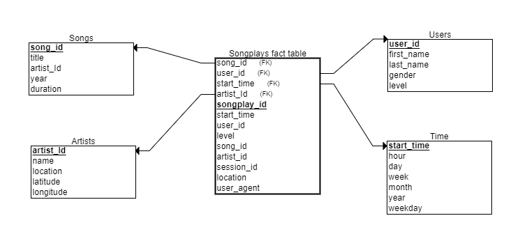

# Data Modelling with Postgres

A Postgres star schema and Python ETL pipeline that loads JSON song metadata and user activity logs into tables designed for song play analysis.

## About

This is an early data engineering learning project from May 2021. The scenario is Sparkify, a music streaming service whose song metadata and app activity logs arrive as JSON files. The task was to design a database schema optimised for queries about which songs users play, and to build an ETL pipeline that fills it.

## Schema

A star schema with one fact table and four dimension tables:



| Table | Type | Columns |
| --- | --- | --- |
| `songplays` | Fact | `songplay_id` (SERIAL, primary key), `start_time`, `user_id`, `level`, `song_id`, `artist_id`, `session_id`, `location`, `user_agent` |
| `users` | Dimension | `user_id` (primary key), `first_name`, `last_name`, `gender`, `level` |
| `songs` | Dimension | `song_id` (primary key), `title`, `artist_id`, `year`, `duration` |
| `artists` | Dimension | `artist_id` (primary key), `name`, `location`, `latitude`, `longitude` |
| `time` | Dimension | `start_time` (primary key), `hour`, `day`, `week`, `month`, `year`, `weekday` |

The diagram marks the links from `songplays` to the dimension tables as foreign keys. In the SQL they are plain columns: no foreign key constraints are declared.

## How the pipeline works

- `create_tables.py` connects to a default database, drops and recreates `sparkifydb` (UTF-8), then creates the five tables. It resets everything on every run.
- `etl.py` walks `data/song_data` and `data/log_data` for `*.json` files, processes each file and commits after each one, printing progress as it goes.
- Song files hold one song each. Each file adds a row to `songs` and to `artists`, skipping duplicates (`ON CONFLICT DO NOTHING`).
- Log files hold one event per line. Only `NextSong` events (song plays) are kept. The millisecond `ts` field becomes a timestamp, which is split into hour, day, week of year, month, year and weekday for the `time` table.
- Users are upserted: on a repeat `user_id` the row's `level` (free or paid) is updated to the value from the event being processed.
- For each play, the song and artist IDs are looked up by matching song title, artist name and duration against `songs` and `artists`. Plays with no match are still recorded in `songplays`, with `song_id` and `artist_id` left null.

## Files

| File | Purpose |
| --- | --- |
| `sql_queries.py` | SQL to drop, create and insert into each table, plus the song lookup query |
| `create_tables.py` | Recreates the database and tables |
| `etl.py` | Processes every song and log file and loads the tables |
| `etl.ipynb` | Notebook that develops the ETL steps on a single song file and a single log file |
| `test.ipynb` | Notebook that selects the first five rows of each table to check the load |
| `Capture.PNG` | Star schema diagram |

## Running it locally

You need a local PostgreSQL server and Python with `psycopg2` and `pandas`. The notebooks also need Jupyter and the `ipython-sql` extension (for the `%sql` magic).

1. **Database connection.** Connection details are hard-coded in `create_tables.py`, `etl.py` and both notebooks: host `127.0.0.1`, user `student`. `create_tables.py` connects first to a database called `studentdb` to recreate `sparkifydb`; everything else connects to `sparkifydb`. Either create a matching role (it needs permission to create databases) and a `studentdb` database, or edit the connection strings to suit your setup.
2. **Data.** The dataset is not included in this repository. `etl.py` expects line-delimited JSON files under `data/song_data` (song and artist fields such as `song_id`, `title`, `artist_name`, `duration`) and `data/log_data` (activity events with fields such as `ts`, `userId`, `level`, `song`, `artist`, `length`, `sessionId`, `page`), relative to the folder you run it from.
3. **Run the scripts:**

   ```bash
   python create_tables.py
   python etl.py
   ```

4. **Check the load** by opening `test.ipynb` in Jupyter. Restart the notebook kernel afterwards to close its connection, otherwise `create_tables.py` cannot drop the database on the next run.

Compatibility note: the notebooks were run on Python 3.6 with an older pandas. `etl.py` uses `Series.dt.weekofyear`, which was removed in pandas 2.0, so either install pandas 1.x or replace it with `t.dt.isocalendar().week`.

## Example queries

Number of users on each membership level:

```sql
SELECT level, COUNT(*) AS users
FROM users
GROUP BY level;
```

Song plays by hour of day:

```sql
SELECT t.hour, COUNT(*) AS plays
FROM songplays sp
JOIN time t ON sp.start_time = t.start_time
GROUP BY t.hour
ORDER BY t.hour;
```

## Author

Daniel Olliver, [danielolliver.com](https://danielolliver.com/)
